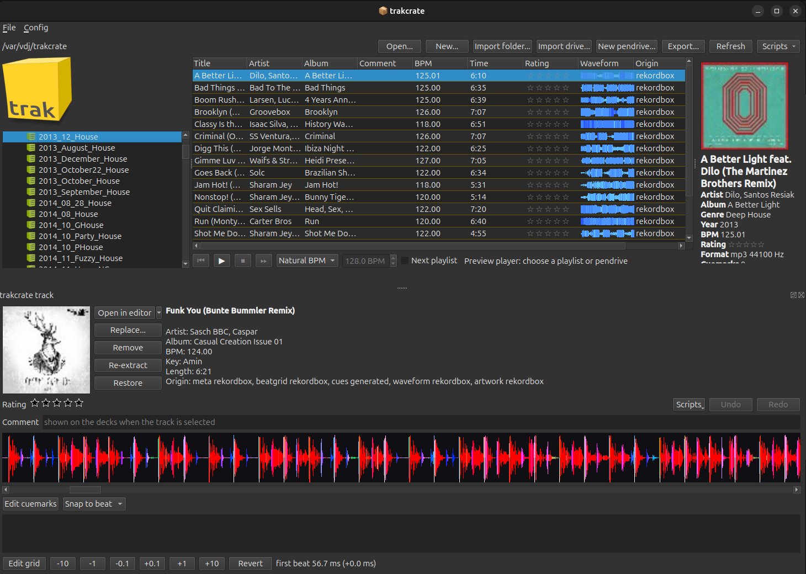
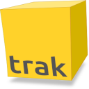
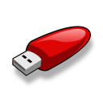
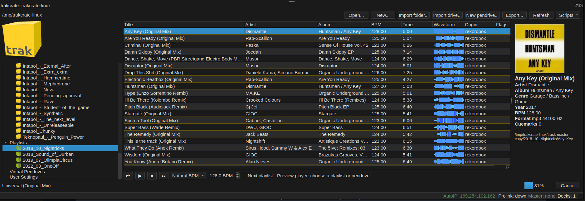
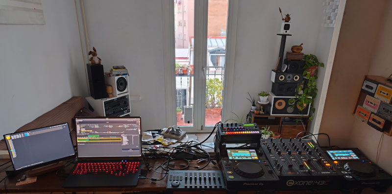

#  A QT based GUI for vdj  

### A Linux PIONEER <span style="color:#cc0000">rekor<span style="color:#eeeeee">db</span>ox</span> alternative

Built from the ground up in C/C++. Provides many of the features of <span style="color:#cc0000">rekor<span style="color:#eeeeee">db</span>ox</span> and quite a few extras.

 

## Features

- **Local music management**
  - Prepare playlists and rekordbox metadata
    - Preview audio and cue points
    - Generate Beat grids
    - Generate Waverforms
    - Store and copy CDJ/XDJ settings files
  - Prepare "Virtual Pendrives" for rekordbox export
    - Pre-prepare pendrives before export, balancing the size in Gigabyte to the drives you own.
    - Export to physical Pendrives in rekordbox format for playing on Nexus CDJ/XDJ
    - Make multiple clones of pendrives, i.e. for bringing spare pendrives to gigs
  - Import
    - Import tracks and metadata from physical pendrives
- **Sync to running CDJ/XDJ**
  - Appear as a virtual deck to real CDJ/XDJ decks
  - Beat mix midi hardware, e.g. ability to sync a 909 to playing CDJ/XDJ decks, with auto sync and manual nudge.
  - Become MASTER and control BPM the mix
  - Export 1 or more pendrives connected to the computer, so real CDJ/XDJ can play tracks from a Linux PC.
  - Export folders of music on the PC, as if it was a pendrive, but without pendrive hardware.
  - Read remote pendrives on playing CDJ/XDJ decks
  - Control the MIDI hardware with a gaming controller, midi controller or spare XDJ deck in midi controller mode
- **DJ Tools**
  - Output audio to a DJ mixer from
    - PC soundcard
    - XDJ which can act as a USB sound cards
    - USB to external audio mixers
  - Add extra kicks
  - Add stabs
  - Play one-shot samples
  - Play loops
  - DR-6S - simple 4/4 drum machine
  - LADSAP FX for all DJ Tools, inc Allen & Heath like Xone filter.

N.B. while you can play music off the PC on physical decks, VDJ does not have a Traktor like player for DJing audio on the PC
This software is a companion to real CDJ/XDJ decks, not an alternative.
For Linux DJ software for mixing audio see [Mixxx](https://github.com/mixxxdj/mixxx)

## Building

```sh
cmake -B build
cmake --build build
```

Run the unit and integration tests:

```sh
ctest --test-dir build
```

## Running vdj-ui

Running vdj-ui requires a port mapper on port 111, which requires root, after each build of the binary run

```
sudo setcap cap_net_bind_service=+ep build/src/vdj-ui
```

this also works `sudo sysctl -w net.ipv4.ip_unprivileged_port_start=111`

You also need AutoIP, the UI can handle this for you.  You can also set this up permanently if you have a network card dedicated for accessing the CDJ/XDJs

See [Linux netowrking](LINUX_NETWORKING.md) for details and options.

## Usage

```sh
./build/vdj-ui                  # start the GUI
./build/vdj-ui --debug          # start with the debug packet log panel open
./build/vdj-ui --mock-beat      # run with interior mock beat data (no network)
```

### Keyboard

- `F11` toggle full screen
- `Ctrl+D` toggle the debug packet log panel
- `Ctrl+Q` quit
- Play/pause, sync to master, become master, copy BPM, and pitch nudge have
  configurable shortcuts for low-light operation

### Sync aka Difflock (the VDJ's ALSA sequencer follows a deck)

The VDJ deck owns an ALSA sequencer (client `vdj-ui`, port `MIDI clock`; connect drum machines to it with
`aconnect`). Its Play button starts and stops the MIDI clock. Click **Sync** on another deck to *difflock* the
sequencer to that deck: the offset between the deck's beat and the sequencer's beat is measured on every beat and,
on the last beat of each bar, the sequencer is nudged (at most 20 ms) towards the offset set in the panel's
spinner (default 0 ms). Same idea as `adj`'s difflock.

- **Follow master** locks to whichever deck is master; **Off** unlocks; **Capture** uses the measured offset as the target
- **-10 -1 +1 +10** nudge the sequencer: the next beat is that many ms longer (+) or shorter (-). While locked the
  target moves with the nudge so the lock keeps the new alignment
- Keys (as in adj): `Shift+U I O P` lock to deck 1-4, `Esc Esc` off, `Shift+M` follow master, `<` `>` change the offset

### Master mode

The vdj-ui can act as the timekeeping master for up to 3 other physical Pioneer CDJ/XDJ.  
Pressing sync on the physical decks will make them follow the BPM of the vdj-ui's ALSA sequencer.


###  Network 

Select a network interface to connect to the ProLink network. The application
lists connected decks, shows the master, BPM with two decimal places, and
renders each deck's beat grid aligned across all deck rows. The Network > AutoIP
menu item starts the link-local address helper (avahi-autoipd based,
polkit prompt for root, start/stop toggle). NFS shares from connected
players are mounted under `~/.cache/vdj-ui/mnt/` and released on shutdown.

The interface for the decks is asked once and saved; Config > *Forget Saved Network Interface* asks again (use it when the NIC changes). The status bar shows
`Prolink:` (the link state), `Master:` (grey when none, the deck-master yellow otherwise) and `AutoIP:` (green with the address whenever the interface has a 169.254.x.x address,
whoever assigned it). When AutoIP gets no address in time and NetworkManager is present, vdj-ui offers to enable link-local on the connection with `nmcli`
(`ipv4.link-local enabled`, left enabled afterwards). Config > *Application Font...* sets the font for the whole app (default Liberation Sans, package `fonts-liberation`).

see [LINUX_NETWORKING.md](LINUX_NETWORKING.md)


### DJ Tools

*View > DJ Tools* shows the live DJ Tools. It plays in time with the VDJ sequencer (the clock the decks follow), so it is silent while the
sequencer is stopped. Hiding the panel does not stop it. Samples are `.wav` files; *Sample folder...* chooses the folder shown in the tree
(double click a file to hear it). 

*Add tool* adds any number of:

- **Bombomatic**: the sample on every beat (a kick to keep the beat through a breakdown). *1 bar* plays one bar of it.
- **Dembomatik**: the dembow kick. The bar is cut into 16 equal parts and the sample plays on `X . . X . . X . X . . . . X . .` (parts 1, 4, 7, 9
  and 14). *1 bar* plays one bar of it.
  Its *swing* slider (0-127) delays every second sixteenth note (the 2nd and 4th of each beat): 127 is a quarter of a beat, one step.
- **DR-6S**: a drum machine of six voices, BD SD SY CL HH OH, in a row of buttons; the lit one is the voice you are editing. Each voice has its own
  sample (the same chooser with preview and up / down arrows), offset, volume, choke and a pattern of 16 steps, the bar cut in sixteenths:
  click a round step for on (red), click it again for off (yellow), Ctrl+click for half volume (pink); a plain click on a pink step turns it off. The wheel over the editor changes the voice's volume
  (Shift: steps of 10); anywhere else over the tool (and over the swing slider) it changes the whole kit's volume. *Choke* cuts every hit of the voice
  off after 1, 2, 4, 8 or 16 quarter beats (off = play to the end) with a fade over 100 ms, e.g. to shorten a long open hi-hat. *Swing* is the same as the
  Dembomatik's. The tool takes a whole row of the grid. *Kit*, *Save kit* and *Delete* keep **drum kits** (the six voices and the swing, not the
  tool's name, switch or volume) in `drum-kits/` of the config folder, apart from the DJ Tools presets; the kit list is shared by all DR-6S tools.
  *Save kit > Export to Folder...* copies the (up to six) samples the kit uses into an empty folder, with a `drumkit.json` that loads the kit back
  (the original samples are only read). To use such folders on this or another PC add them in Config > Instruments > *Presets*: their kits
  appear in every DR-6S list (read only; the folder must stay where it is).
  Alt+click (or middle click) on a voice button mutes that voice (it is dimmed); the mute is saved with the tool but not in kits.
  The tool switch (and its F key) mutes the whole machine; *1 bar* plays one bar of the pattern.
- **Stab player**: the sample on the beats of the bar you choose (the round buttons: red = on, yellow = off). *Reverse sync* makes the sample
  end on the beat instead of starting on it. *1 bar* (green) plays exactly one bar from the next bar line, even when the tool is switched off.
- **Acid loop**: a sample that is a 4 beat loop, time-stretched to the sequencer's BPM and started on the bar line. *1 bar* plays one pass.
  The loop's BPM comes from the file (`acid` chunk, or `128bpm` in the name) or the BPM box; with none it is assumed to be 4 beats long.
- **One shot**: *Fire* plays the sample once, on the next beat (*Quantize*) and stretched to the BPM when it is known (*Stretch*).
- **MIDI matic**: a MIDI note on the chosen beats to an ALSA port (device, channel, note). It leaves the *DJ Tools MIDI* port of the `vdj-ui`
  ALSA client; with no device chosen it goes to whatever is connected to that port.

- **FX**: an effect on everything vdj-ui plays itself (the DJ Tools and the local track player), any **LADSPA** plugin with one or two audio
  inputs and outputs (filters, reverbs, delays ... the standard Linux effects, e.g. packages `swh-plugins`, `caps`, `lsp-plugins-ladspa`).
  Pick the plugin in the *effect* list and one slider per knob of the plugin appears; the on/off switch bypasses it. Several FX tools run one
  after the other in the order of the panel. The decks' own outputs do not pass through vdj-ui, so they are not affected. Plugins are
  searched in `$LADSPA_PATH` (else `/usr/lib/ladspa`, `/usr/local/lib/ladspa`, `~/.ladspa`) and in the `ladspa` folder next to the program.
  vdj-ui ships the **Xone filter** (`xone-ladspa.so`, also usable in other LADSPA hosts): the high pass filter of the LMMS *Xone* effect, with
  the same two knobs, *Freq* (the cutoff, 10-14000 Hz) and *Wild* (0.01-6.5, the resonance at the cutoff). Unlike LMMS the resonance fades out
  towards 10 Hz (full from 80 Hz up), so with Freq right down the filter does nothing, even at full Wild.
  In *Controller: Tools* mode the strip of an FX tool drives two of its controls: the **knob** one and the **fader** another, chosen in the *knob* and
  *fader* lists of the tool (default the plugin's first and second, i.e. Freq and Wild), with the usual pickup.

Every tool has a name, an on/off switch and an **offset** of +/- 80 ms to the beat. The arrows next to a sample name step to the previous /
next `.wav` of the same folder (ascibetical); the new sample is used from the tool's next hit, so you can flick through kicks live.
*Preset* saves and loads the whole set-up (tools, settings, folder, volume) as JSON in the config folder (`djtoolz-presets/`); the
working state is kept in `djtoolz-current.json` and comes back at the next start.

The DJ Tools plays on the output chosen for the Local Track Player. Sounds are rendered ahead of the beat by the sound server's buffer,
40 ms by default; if the kick sounds early or late put `latency_ms=40` (change the number) in `djtoolz.conf` in the config folder. In debug mode (*View > Debug Panel*)
each sound start is logged with how far it was rendered from its scheduled time (a few microseconds is normal).

#### Controlling the DJ Tools with MIDI (nanoKONTROL Studio)

A MIDI controller with 8 strips (mute, solo, rec, select buttons, a knob and a fader each, plus track back / forward) can drive the DJ Tools.
Connect it to the *vdj-midi-in* ALSA port that the deck maps use (*Config > Instruments*, or `aconnect`; a second controller can be wired
automatically with `midi_input_djtoolz=<device key>` in the `[instruments]` section of the config). The *Controller: Tools / DR-6S* box in the
DJ Tools panel picks what the strips drive, one mode at a time:

| control | Tools mode (strip n = tool n, the F1..F12 order) | DR-6S mode (strip n = voice n: BD SD SY CL HH OH) |
|---|---|---|
| mute | the tool's on / off | the voice on / off (a muted voice is dimmed; Alt+click or middle click on a voice button does the same) |
| solo | the green button (1 bar / Fire) | - |
| rec / select | next / previous sample in the folder | - |
| knob | offset, -40 ms .. +40 ms (middle = 0); FX tool: its *knob* control | the voice's offset |
| fader | the tool's volume 0-127; FX tool: its *fader* control | the voice's volume |
| track back / forward | - | previous / next drum kit |

With several DR-6S tools the one you touched last is driven (else the first). Faders and knobs use **pickup**: after a mode change, a preset
load or a change made with the mouse they do nothing until they reach the value on screen, so the sound never jumps. A voice mute is saved with
the tool and the presets, not in drum kits. The controller is never given LED feedback.

The mapping is a normal adj `.adjmm` file (`<config folder>/djtoolz-control.adjmm`, or `djtoolz_map=` in the `[midi]` section), the same format
as the deck maps and the one `adj_midilearn` writes, so it can also be the same file as the deck map. Each line is `name channel controller value`
(channel 0 = any, `N` as the controller = a note, `*` = any value; `#` starts a comment). The names are `strip1_mute`, `strip1_solo`, `strip1_rec`,
`strip1_select`, `strip1_knob`, `strip1_fader` ... `strip8_*`, `track_back`, `track_fwd` and `mode_toggle`. Lines starting with `#!` are settings:
`#! source nanoKONTROL` (only events from a MIDI client with that in its name), `#! pickup 1` and `#! rec_is_forward 1` (rec = next sample;
0 swaps rec and select). Other lines (the deck's `start`, `stop` ...) are ignored by the DJ Tools, and `adj` ignores the DJ Tools lines.
**The numbers in the example file the program creates are a guess** (a nanoKONTROL2 style layout); use *Controller...* in the DJ Tools panel:
select a cell, press *Learn* and move or press that control (*learn strip 1 fills the row* fills strips 2-8 with the next numbers), then *Save*.
Once a control is learned the dialog moves on to the next cell down by itself, so you can go through a whole strip column in one go; *Skip* (or the Tab key) leaves a cell as it is and moves on. Saving changes only the lines you edited; everything else in the file is kept. *View > MIDI monitor* shows the raw events.

### Exporting a pendrive to the decks (LINK export)

Network > *Export the Loaded Database as a LINK Player* makes vdj-ui serve the rekordbox database open in the browser (a pendrive or export folder) to the
other decks like a player with a USB stick in it: they browse it, load tracks and play them. It needs UDP port 111, a privileged port.
See `doc/link-export.md` and `doc/privileged-port-111.md`. (`doc/joining-the-link.md` explains how the virtual player joins the link without the decks complaining.)

#### PC Laoded pendrives, USB STOP and Insert

The drive viewer has a tool bar with a list of your virtual pendrives (named folders, managed in Network > *Exported Pendrive* > *Manage Virtual Pendrives...*) and the
pendrives plugged into the PC, and the buttons **USB STOP** and **Insert**. Choosing a pendrive only shows it in the viewer; *Insert* exports it to the decks and *USB STOP*
unmounts the exported one, like the buttons on a deck (USB STOP is dimmed when a deck is using the stick and would refuse). **Run with `VDJ_UI_MODEL=XDJ`**: the decks only
follow the switching when vdj-ui announces itself like an XDJ-700. See `doc/link-export.md`.

## Packaging a .deb

```sh
cmake -B build
cmake --build build
make -C build deb        # produces vdj-ui_<version>_<arch>.deb in build/
```

### Note for packagers

Pioneer uses AutoIP for networking `169.254.0.0` and NFS v1 for sharing files and portmapper to find nfs mounts.  
I had to build a ground up portmapper and nfs v1 implementation to connect to as a virtual CDJ.
portmapper requires port 111, which requires root. There are tricks to avoid this.
Linux built in portmapper can be made to work. Modern Linux built in NFS can not.

I run vdj-ui Ubuntu 24.04 LTS from source, [libcdj](https://github.com/teknopaul/libcdj) works on other platform such as the raspberry pi,  I have not bothered with packaging it yet.

See [Linux netowrking](LINUX_NETWORKING.md) for details and options or how to setup NICs for Prolink access.

vdj-ui is not going to work in flatpack or snap or other Linux container technologies. It requires access to USB drives and Network cards, and sometimes need to escalate privs to root.

## Man page

```sh
man -l doc/vdj-ui.1
```

# Trakcrate



Trakcrate is a Linux alternative to the rekordbox database on a PC or Mac. 

It supports most of the important features of rekordbox such as creating waveforms and Beat grid analysis and preparing playlists and exporting them to pendrives.


### trakcrate db format

The database backing trakcrate is an open format so its hackable. You can create and manage trakcrate dbs with vdj-ui or there it a command line tool `trakcrate`
that can also be used to manage the database, e.g over ssh.  
The database is basically base directory containing sub-directories with audios files and their associate, artwork, beat grids, metadata, and waveforms.
These are all available on the file system so you can edit meta data with `vim` or write you own artwork editors, edit artwork in `gimp` or other graphics tools.
You can use vdj-ui's built in waveform and beat grid analyzers, the cli versions, use files exported from real pioneer rekordbox databases, or write your own.

vdj-ui support track and database scripts that can be written in any language for managing the trakcrate database.

Text data is stored as text files so you can search with `grep` and edit with `sed` for writing mass updates, e.g removing that annoying "(Original Mix)" suffix that Beatport add on to all tracks.

The ordering of a playlists is important, in trakcrate it is simply numbered symbolic links, so you can drag n drop in the GUI or use standard Linux cli tools to modify them.

### trakcrate virtual pendrives



Trakcrate also supports "virtual pendrives" these are pre-prepared lists of playlist and metadata for export to one or more physical pendrives.  
I always take 3 copies of my pendrives to a gig because Pioneer decks kills them eventually with lots of little writes the SDs do not like.

Naturally, virtual pendrives can be exported to Pioneers rekordbox format.

It is a good idea to start a trakcrate database by importing a pendrive, then you get your preferred deck settings that are also stored in the rekordbox database.
Currently trakcrate has no editor for CDJ settings files, because I don't use that feature.


[trakcrate database spec](TRAKCRATE-FORMAT.md)

## VDJ-UI Screenshot

vdj-ui connected to the Prolink Network syncing ALSA Midi sequencer to a physical XDJ.


## Trakcrate

Screenshot of the Trakcrate database UI, showing Folders and editable Playlists.

 

## Home setup

1 x Xone mixer for mixing audio.

2 x XDJ-700 used to play tracks from plugged in pendrives, or from the Laptop via plugged in pendrive, or rekordbox folders stored on the Laptop.  

1 x Korg nanaKONTROL used to control the DJ Tools in vdj-ui.  

1 x Roland TR-6S Drum machine that, via VDJ-U, is controlled by an XDJ-700.

Main laptop screen has vdj-ui syncing the MIDI devices and playing audio.

Second screen has Trakcrate loaded for preparing playlist and creating pendrives for use on CDJs.




# License

Copywrite [teknopaul 2026](http://teknopaul.com).

This software is licensed un [GPLv3](https://www.gnu.org/licenses/gpl-3.0.en.html)  
Images and artwork under [Creative Commons 4.0](https://creativecommons.org/licenses/by-nc/4.0/)

Basically these mean free to use, copy, and modify, but you must attribute the authors and cannot sell direct copies.

There is no Pioneer IP in this software and there was no reverse engineering of Pioneer software done to write it.
As stated at the top, it is a ground up rewrite.

Props to [Deepseek community](https://djl-analysis.deepsymmetry.org/djl-analysis/packets.html) for Prolink analysis.

Rekordbox was the only Windows application I had left, so I wrote this tool to finally be free of closed source software and operating systems.


I have only replicated network traffic from XDJ-700 and XDJ-1000 since that is the only hardware I have.  
I don't have a paid for license of rekordbox, just the free version 4.0 for Windows so there are no network features like when decks connect to a PC as rekordbox.  
vdj-ui connects as a player since I can see what players do using a port mirroring switch.
Since I don't have any pcap tcpdump files of real rekordbox CDJ/XDJ interactions I cant write that part.  
If you can send pcaps of the TCP and UDP communication between software rekordbox and physical decks, I can can give it a try.

I have replicated pendrive features just by reading them and seeing what they do.  Its a binary format but its readable,  there are however some features of rekordbox db that I don't understand and thus cannot replicate.
This repo has lots of documentation if you want to contribute knowledge to the writing of rekordbox DBs.

# Contributing

I'm happy to receive bug reports and feature ideas.

Keen to get pcap dumps from other Pioneer hardware interactions. You need a port mirroring switch for this, e.g TEROW DJA-SG2005 cloud managed switch that costs 35 bucks.

Happy to get midi maps for other midi controllers.  and module for other joysticks and gaming controllers

