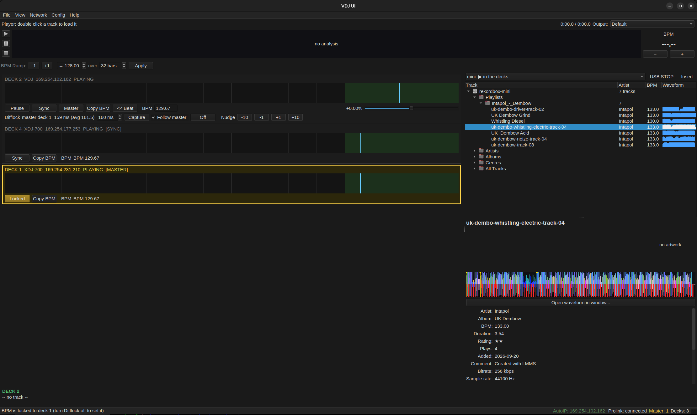

# A QT based GUI for vdj  

## Building

```sh
cmake -B build
cmake --build build
```

Run the unit and integration tests:

```sh
ctest --test-dir build
```

## Usage

```sh
./build/vdj-ui                  # start the GUI
./build/vdj-ui --debug          # start with the debug packet log panel open
./build/vdj-ui --mock-beat      # run with interior mock beat data (no network)
```

### Keyboard

- `F11` toggle full screen
- `Ctrl+D` toggle the debug packet log panel
- `Ctrl+Q` quit
- Play/pause, sync to master, become master, copy BPM, and pitch nudge have
  configurable shortcuts for low-light operation

### Difflock (the VDJ's ALSA sequencer follows a deck)

The VDJ deck owns an ALSA sequencer (client `vdj-ui`, port `MIDI clock`; connect drum machines to it with
`aconnect`). Its Play button starts and stops the MIDI clock. Click **Sync** on another deck to *difflock* the
sequencer to that deck: the offset between the deck's beat and the sequencer's beat is measured on every beat and,
on the last beat of each bar, the sequencer is nudged (at most 20 ms) towards the offset set in the panel's
spinner (default 20 ms). Same idea as `adj`'s difflock.

- **Follow master** locks to whichever deck is master; **Off** unlocks; **Capture** uses the measured offset as the target
- **-10 -1 +1 +10** nudge the sequencer: the next beat is that many ms longer (+) or shorter (-). While locked the
  target moves with the nudge so the lock keeps the new alignment
- Keys (as in adj): `Shift+U I O P` lock to deck 1-4, `Esc Esc` off, `Shift+M` follow master, `<` `>` change the offset

### Network

Select a network interface to connect to the ProLink network. The application
lists connected decks, shows the master, BPM with two decimal places, and
renders each deck's beat grid aligned across all deck rows. The Network > AutoIP
menu item starts the link-local address helper (avahi-autoipd based,
polkit prompt for root, start/stop toggle). NFS shares from connected
players are mounted under `~/.cache/vdj-ui/mnt/` and released on shutdown.

The interface for the decks is asked once and saved; Config > *Forget Saved Network Interface* asks again (use it when the NIC changes). The status bar shows
`Prolink:` (the link state), `Master:` (grey when none, the deck-master yellow otherwise) and `AutoIP:` (green with the address whenever the interface has a 169.254.x.x address,
whoever assigned it). When AutoIP gets no address in time and NetworkManager is present, vdj-ui offers to enable link-local on the connection with `nmcli`
(`ipv4.link-local enabled`, left enabled afterwards). Config > *Application Font...* sets the font for the whole app (default Liberation Sans, package `fonts-liberation`).

### Exporting a pendrive to the decks (LINK export)

Network > *Export the Loaded Database as a LINK Player* makes vdj-ui serve the rekordbox database open in the browser (a pendrive or export folder) to the
other decks like a player with a USB stick in it: they browse it, load tracks and play them. It needs UDP port 111, a privileged port.
See `doc/link-export.md` and `doc/privileged-port-111.md`. (`doc/joining-the-link.md` explains how the virtual player joins the link without the decks complaining.)

#### Virtual pendrives, USB STOP and Insert

The drive viewer has a tool bar with a list of your virtual pendrives (named folders, managed in Network > *Exported Pendrive* > *Manage Virtual Pendrives...*) and the
pendrives plugged into the PC, and the buttons **USB STOP** and **Insert**. Choosing a pendrive only shows it in the viewer; *Insert* exports it to the decks and *USB STOP*
unmounts the exported one, like the buttons on a deck (USB STOP is dimmed when a deck is using the stick and would refuse). **Run with `VDJ_UI_MODEL=XDJ`**: the decks only
follow the switching when vdj-ui announces itself like an XDJ-700. See `doc/link-export.md`.

## Packaging a .deb

```sh
cmake -B build
cmake --build build
make -C build deb        # produces vdj-ui_<version>_<arch>.deb in build/
````

## Man page

```sh
man -l doc/vdj-ui.1
```



